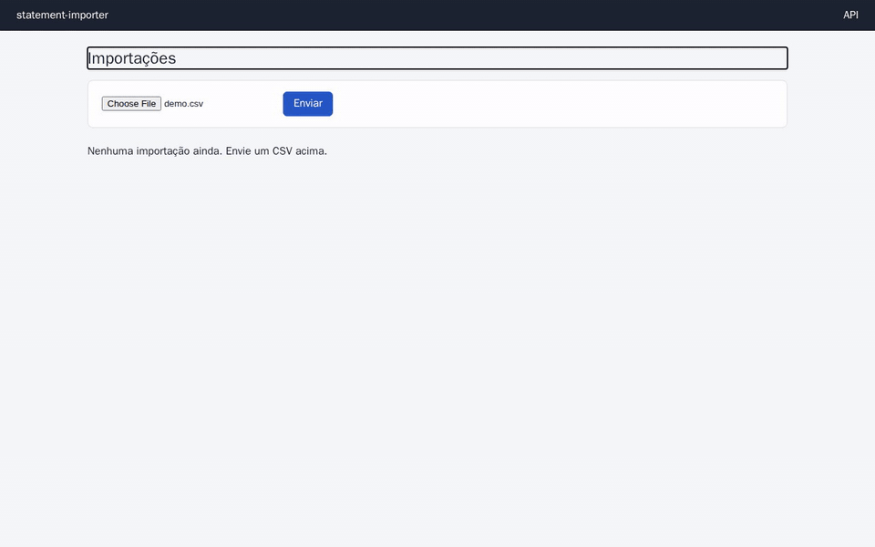
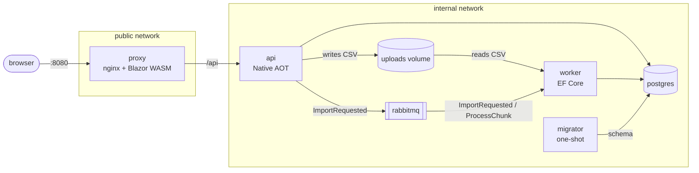

# statement-importer

[](https://github.com/YudiKojima/statement-importer/actions/workflows/ci.yml)

Async CSV bank-statement import pipeline: a .NET 10 Docker portfolio project.

## The problem

Importing a large CSV inside an HTTP request times out, duplicates data when the user retries, and shows no progress. This project solves that with an asynchronous pipeline: the API stores the file and responds immediately, and workers process the CSV in idempotent chunks.

Every Docker concept here (image, build, volume, network, compose) exists because the system needs it, and the key claims below are checked by executable proofs in CI.

## Demo



One million lines, three workers, sped up 2×. The UI is in Portuguese.

## Architecture



- **proxy**: unprivileged nginx. Serves the Blazor WebAssembly frontend and forwards `/api`. The only published port (8080).
- **api**: Minimal API in Native AOT on a chiseled image with no shell. Streams the upload to disk, computes its SHA-256 and publishes to the queue.
- **worker**: EF Core. Processes 10,000-line chunks and acks only after the commit, so a killed worker never duplicates data.
- **migrator**: EF Core migrations bundle. Runs once and exits before `api` and `worker` start.
- **postgres 17** and **rabbitmq 4** (quorum queues), internal network only.

## Quick start

Requires Docker with Compose. The .NET 10 SDK is needed only for the CSV generator.

```bash
for s in postgres_password db_owner_password db_app_password; do cp secrets/$s.txt.example secrets/$s.txt; done
docker compose up -d --wait
```

Open `http://localhost:8080` to upload a file and follow its progress, rejected lines and imported transactions. Interactive API docs are at `http://localhost:8080/api/docs`.

To generate a 1M-line CSV and send it with `curl`:

```bash
dotnet run tools/generate-csv.cs -- --lines 1000000 --seed 42 --out data/1m.csv
curl -X POST --data-binary @data/1m.csv -H "Content-Type: text/csv" "localhost:8080/api/imports?fileName=1m.csv"
```

The `202` response carries the `id`; progress is at `GET localhost:8080/api/imports/{id}`.

To compare one and three workers: `docker compose up -d --wait --scale worker=3`.

## Verified measurements

Taken on the real stack, using this repository's `compose.yml`. Timings are from a local machine; the slower CI runners take ~67 s with 1 worker and ~28 s with 3.

| Scenario | Result |
|---|---|
| Upload of 1M lines (~50 MB) | `202` in ~0.25 s |
| Processing with 1 worker | ~36 s |
| Processing with 3 workers | ~15 s |
| `docker kill` on a worker mid-import | exact count, zero duplicates |
| RabbitMQ stopped | `api` and `worker` restart through the restart policy and return `healthy` |
| `process-chunk` queue purged | the reconciler republishes the 81 pending chunks |
| Upload above 200 MiB | `413`, no file left behind |
| Compressed image size (CI) | `api` 17.3 MB · `worker` 44.5 MB · `migrator` 49.4 MB · `proxy` 32.0 MB |
| Container user | UID 1654 (non-root); UID 101 on the proxy |

On every pull request and push to `master`, proofs fail the build if a killed worker breaks the exact count, if the `413` is missing, if an image exceeds its size target or if a container runs as root. The 1 × 3 worker timings are reported by CI but are not pass/fail. The upload time, the absence of leftover files and the RabbitMQ and reconciler rows were measured by hand. Each CI run's job summary shows the sizes, the timings and a CVE comparison between the chiseled and standard images.

## Design decisions

Each record explains the context and alternatives, in Portuguese.

- [**Native AOT API, EF Core worker**](docs/architecture/decisions/0001-api-aot-worker-ef-core.md): a small, fast-starting API image with Dapper.AOT; the worker keeps EF Core, whose AOT support is experimental, for migrations and transactions.
- [**Healthcheck from the binary itself**](docs/architecture/decisions/0002-healthcheck-pelo-proprio-binario.md): shell-less images have no `curl`, so the app checks itself.
- [**Idempotent chunks, ack after commit**](docs/architecture/decisions/0003-processamento-em-blocos-idempotente.md): a crash means reprocessing, never duplicates.
- [**CPU and memory limits on the worker**](docs/architecture/decisions/0004-limite-de-recursos-no-worker.md): 0.5 CPU and 256 MB make scaling measurable and protect the host.
- [**One-shot migrator**](docs/architecture/decisions/0005-schema-do-ef-core-aplicado-por-migrator.md): the schema is applied by a dedicated container, not by the apps at startup.
- [**Least-privilege database roles**](docs/architecture/decisions/0006-papeis-de-banco-com-privilegio-minimo.md): `api` and `worker` only read and write data; the `migrator` owns the schema.
- [**Executable proofs against the real stack**](docs/architecture/decisions/0007-provas-executaveis-contra-o-stack-real.md): the README's key container claims are checked in CI, not just stated.
- [**Proxy as the single edge**](docs/architecture/decisions/0008-proxy-como-unica-borda.md): one nginx serves the frontend and `/api`, and the API stays on the internal network.

## Proofs

With the stack running:

```bash
bash proofs/run-all.sh
```

It takes a few minutes and includes three 1M-line imports. Each proof also runs alone, for example `bash proofs/resilience.sh`. If your machine already uses ports 5432, 5672 or 15672, run `IGNORE_HOST_PORTS=5432 bash proofs/run-all.sh`; CI never sets this variable.

| Proof | What it checks |
|---|---|
| `healthy.sh` | Every service is healthy within 60 s and the migrator exits with code 0 |
| `network.sh` | Only the proxy publishes a port; the API is on the internal network only |
| `proxy.sh` | SPA fallback, `/api` forwarding and the 200 MiB upload limit |
| `security.sh` | No root in any app image; no shell in `api` and `worker`; low-privilege database role |
| `image-size.sh` | Compressed image sizes within target |
| `volume.sh` | Data survives `compose down` + `up` |
| `scale.sh` | Measures 1 × 3 workers on a 1M-line import |
| `resilience.sh` | Killing a worker mid-import still gives an exact count |

CI also runs 39 unit tests and 21 integration tests with Testcontainers (real Postgres and RabbitMQ), scans the images with Trivy and publishes them to GHCR.

## Recording the demo

`bash tools/demo/record.sh` regenerates `docs/assets/demo.gif` with Playwright and ffmpeg in a container. It rebuilds the images and deletes the stack's volumes so the demo starts from an empty database.

## Documentation

In Portuguese:

- [System design](docs/architecture/system-design.md): services, data flow, images, tests and CI.
- [Architecture decision records](docs/architecture/decisions/).
- [Project overview and phases](docs/project-overview.md).
