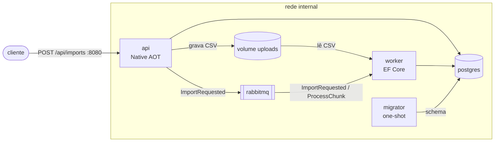

# statement-importer

> README provisório. O README completo, com demo e badge do CI, chega na fase 04.

Importar um CSV grande dentro da requisição HTTP dá timeout, duplica dados quando o usuário reenvia e não mostra progresso. Este projeto resolve isso com um pipeline assíncrono: a API grava o arquivo e responde na hora, e workers processam o CSV em blocos idempotentes.

É um projeto de portfólio de Docker em .NET 10: cada conceito (imagem, build, volume, rede, compose) aparece por uma necessidade real do sistema.

## O que existe hoje (fase 01)

- **api**: Minimal API em Native AOT, imagem chiseled sem shell. Recebe o upload em streaming, calcula o SHA-256 e publica na fila.
- **worker**: EF Core, consome a fila e processa blocos de 10.000 linhas. Ack só depois do commit, então um worker morto não duplica dados.
- **migrator**: bundle de migrations do EF Core, roda uma vez e sai antes de `api` e `worker` subirem.
- **postgres 17** e **rabbitmq 4** (quorum queues), só na rede interna.
- `compose.dev.yml` com Compose Watch para desenvolvimento.
- 39 testes unitários e 21 de integração com Testcontainers (Postgres e RabbitMQ reais).



## Como rodar

Requisitos: Docker com Compose e o SDK do .NET 10 (só para o gerador de CSV).

```bash
cp secrets/db_password.txt.example secrets/db_password.txt
docker compose up -d --wait
```

Gerar um CSV de 1 milhão de linhas e enviar:

```bash
dotnet run tools/generate-csv.cs -- --lines 1000000 --seed 42 --out data/1m.csv
curl -X POST --data-binary @data/1m.csv -H "Content-Type: text/csv" "localhost:8080/api/imports?fileName=1m.csv"
```

A resposta `202` traz o `id`; o progresso fica em `GET localhost:8080/api/imports/{id}`. A documentação interativa está em `localhost:8080/api/docs`.

Para comparar 1 e 3 workers: `docker compose up -d --wait --scale worker=3`.

## Medições verificadas

Feitas no stack real, com o `compose.yml` deste repositório.

| Cenário | Resultado |
|---|---|
| Upload de 1M de linhas (~50 MB) | `202` em ~0,25 s |
| Processamento com 1 worker | ~36 s |
| Processamento com 3 workers | ~15 s |
| `docker kill` num worker no meio da importação | contagem exata, zero duplicatas |
| RabbitMQ parado | `api` e `worker` reiniciam pelo restart policy e voltam `healthy` |
| Fila `process-chunk` esvaziada à força | o reconciliador republica os 81 blocos pendentes |
| Upload acima de 200 MB | `413`, sem deixar arquivo para trás |
| Tamanho comprimido das imagens | `api` 17 MB · `worker` 45 MB · `migrator` 50 MB |
| Usuário dos containers de app | UID 1654 (não root) |

Por enquanto, essas medições foram feitas à mão. Na fase 03 elas viram provas executáveis em `proofs/`, rodando no CI do GitHub Actions.

## Documentação

- [System design](docs/architecture/system-design.md): serviços, fluxo de dados, imagens, testes e CI.
- [Decisões de arquitetura (ADRs)](docs/architecture/decisions/): por que AOT na api, healthcheck pelo próprio binário, blocos idempotentes, limite de recursos no worker e migrator one-shot.
- [Visão do projeto e fases](docs/project-overview.md).
