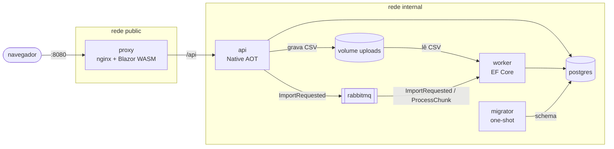

# statement-importer

[](https://github.com/YudiKojima/statement-importer/actions/workflows/ci.yml)

> README provisório. O README completo, com demo, chega na fase 04.

Importar um CSV grande dentro da requisição HTTP dá timeout, duplica dados quando o usuário reenvia e não mostra progresso. Este projeto resolve isso com um pipeline assíncrono: a API grava o arquivo e responde na hora, e workers processam o CSV em blocos idempotentes.

É um projeto de portfólio de Docker em .NET 10: cada conceito (imagem, build, volume, rede, compose) aparece por uma necessidade real do sistema.

## O que existe hoje (fases 01, 03 e 02)

- **proxy**: nginx sem root, serve o frontend Blazor WebAssembly e repassa /api para a api. Única porta publicada (8080).
- **api**: Minimal API em Native AOT, imagem chiseled sem shell, só na rede interna. Recebe o upload em streaming, calcula o SHA-256 e publica na fila.
- **worker**: EF Core, consome a fila e processa blocos de 10.000 linhas. Ack só depois do commit, então um worker morto não duplica dados.
- **migrator**: bundle de migrations do EF Core, roda uma vez e sai antes de `api` e `worker` subirem.
- **postgres 17** e **rabbitmq 4** (quorum queues), só na rede interna.
- `compose.dev.yml` com Compose Watch para desenvolvimento.
- 39 testes unitários e 21 de integração com Testcontainers (Postgres e RabbitMQ reais).
- Papéis de banco com privilégio mínimo: `api` e `worker` só leem e gravam dados; o `migrator` é dono do schema; ninguém usa o superusuário.
- Provas executáveis em `proofs/` e CI no GitHub Actions com Trivy e publicação no GHCR.



## Como rodar

Requisitos: Docker com Compose e o SDK do .NET 10 (só para o gerador de CSV).

```bash
for s in postgres_password db_owner_password db_app_password; do cp secrets/$s.txt.example secrets/$s.txt; done
docker compose up -d --wait
```

Se você já subiu o stack da fase 01, rode `docker compose down -v` uma vez antes: o script que cria os papéis do banco só executa com o `pgdata` vazio.

A interface fica em `http://localhost:8080`: upload, progresso, linhas rejeitadas e transações importadas.

Como alternativa, gere um CSV de 1 milhão de linhas e envie pelo `curl` (que passa pelo proxy):

```bash
dotnet run tools/generate-csv.cs -- --lines 1000000 --seed 42 --out data/1m.csv
curl -X POST --data-binary @data/1m.csv -H "Content-Type: text/csv" "localhost:8080/api/imports?fileName=1m.csv"
```

A resposta `202` traz o `id`; o progresso fica em `GET localhost:8080/api/imports/{id}`. A documentação interativa está em `localhost:8080/api/docs`.

Para comparar 1 e 3 workers: `docker compose up -d --wait --scale worker=3`.

## Medições verificadas

Feitas no stack real, com o `compose.yml` deste repositório.

| Cenário | Resultado |
|---|---|
| Upload de 1M de linhas (~50 MB) | `202` em ~0,25 s |
| Processamento com 1 worker | ~36 s |
| Processamento com 3 workers | ~15 s |
| `docker kill` num worker no meio da importação | contagem exata, zero duplicatas |
| RabbitMQ parado | `api` e `worker` reiniciam pelo restart policy e voltam `healthy` |
| Fila `process-chunk` esvaziada à força | o reconciliador republica os 81 blocos pendentes |
| Upload acima de 200 MB | `413`, sem deixar arquivo para trás |
| Tamanho comprimido das imagens | `api` 18,0 MB · `worker` 46,6 MB · `migrator` 50,6 MB · `proxy` 32,7 MB |
| Usuário dos containers de app | UID 1654 (não root); UID 101 no proxy |

As linhas de 1M de linhas (escala e worker morto), upload acima de 200 MB (o `413` sai do nginx), tamanho das imagens e usuário dos containers são verificadas por provas executáveis em [`proofs/`](proofs/), a cada push, no [CI](.github/workflows/ci.yml), junto com rede, volume, privilégios do banco e saúde do stack. As linhas de RabbitMQ parado e reconciliador foram medidas à mão na fase 01. O job summary de cada execução traz os tamanhos, os tempos de 1 × 3 workers e a comparação de CVEs entre as imagens chiseled e as imagens padrão.

## Como rodar as provas

Com o stack em pé (seção anterior):

```bash
bash proofs/run-all.sh
```

Leva alguns minutos: inclui três importações de 1M de linhas. Cada prova também roda sozinha, por exemplo `bash proofs/resilience.sh`.

Se a máquina já usa as portas 5432, 5672 ou 15672 (um Postgres nativo, por exemplo), ignore-as na prova de rede: `IGNORE_HOST_PORTS=5432 bash proofs/run-all.sh`. O CI nunca define essa variável.

## Documentação

- [System design](docs/architecture/system-design.md): serviços, fluxo de dados, imagens, testes e CI.
- [Decisões de arquitetura (ADRs)](docs/architecture/decisions/): por que AOT na api, healthcheck pelo próprio binário, blocos idempotentes, limite de recursos no worker, migrator one-shot, papéis de banco com privilégio mínimo, provas contra o stack real e proxy como única borda.
- [Visão do projeto e fases](docs/project-overview.md).
