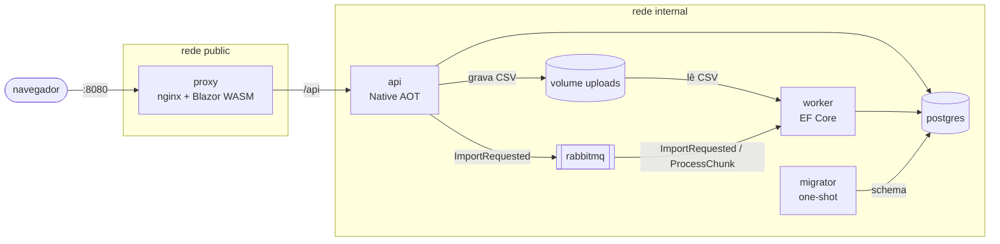

# Fase 02 — Frontend e reverse proxy: plano de implementação

> **Para agentes:** SUB-SKILL OBRIGATÓRIA: usar `superpowers:subagent-driven-development` (recomendado) ou `superpowers:executing-plans` para executar tarefa por tarefa. Os passos usam checkbox (`- [ ]`).

**Objetivo:** frontend Blazor WebAssembly servido por um `proxy` nginx que também repassa `/api` para a `api`; o `proxy` vira a única porta publicada e as provas passam a exigir isso.

**Arquitetura:** um Dockerfile multi-stage em `src/StatementImporter.Web` publica o WASM com o SDK e copia os estáticos para `nginxinc/nginx-unprivileged:1.29-alpine`, junto com `docker/nginx.conf`. A `api` sai da rede `public` e perde a porta. O upload do navegador usa `XMLHttpRequest` via JS interop para enviar o arquivo em streaming. Desenho em [`design.md`](design.md); visão completa em [`../../architecture/system-design.md`](../../architecture/system-design.md).

**Stack:** .NET 10 (Blazor WebAssembly standalone), nginx 1.29 (imagem unprivileged), Docker Compose, Bash (provas), GitHub Actions (bake com cache `type=gha`).

## Restrições globais

- Raiz do repositório: `C:\Program Files\source\statement-importer` (no Git Bash: `/c/Program Files/source/statement-importer`, caminho com espaço — sempre entre aspas). Comandos rodam a partir da raiz, no **Git Bash**.
- **Nunca commitar durante a fase** (regra do [`CLAUDE.md`](../../../CLAUDE.md)). Onde o skill pediria commit, há um **checkpoint**. O commit acontece só na Task 10.
- Docker Desktop rodando. Se `docker info` falhar, pedir ao usuário para abri-lo.
- Esta máquina tem um Postgres nativo na 5432: provas locais com `IGNORE_HOST_PORTS=5432`. O CI nunca define essa variável.
- Imagens de terceiros com tag fixa: `nginxinc/nginx-unprivileged:1.29-alpine`, `mcr.microsoft.com/dotnet/sdk:10.0`. Nada de `latest`.
- `dotnet build StatementImporter.slnx -warnaserror` precisa passar (é o que o CI roda). Warning de trimming/AOT é erro.
- Versões de pacotes só no `Directory.Packages.props` (gerenciamento central).
- Sem comentários que descrevem o que o código faz; só o "por quê" quando não é óbvio.
- Meta de tamanho comprimido: `proxy` < 40 MB (as outras não mudam: `api` < 25, `worker` < 70, `migrator` < 60).
- Limite de upload: 200 MiB em todo lugar (`UploadStorage.MaxUploadBytes = 200L * 1024 * 1024`, `client_max_body_size 200m`, `209715200` no JS).

## Mapa de arquivos

```
src/StatementImporter.Api/Program.cs                      OpenAPI em /api/openapi/{documentName}.json
src/StatementImporter.Web/StatementImporter.Web.csproj    novo: Blazor WASM, linka DTOs do Contracts
src/StatementImporter.Web/Program.cs                      novo: host do WASM, HttpClient, ImportsApi
src/StatementImporter.Web/WebJsonContext.cs               novo: JSON source-generated
src/StatementImporter.Web/ImportsApi.cs                   novo: chamadas GET à api
src/StatementImporter.Web/_Imports.razor · App.razor      novos
src/StatementImporter.Web/Layout/MainLayout.razor         novo
src/StatementImporter.Web/Components/StatusBadge.razor    novo
src/StatementImporter.Web/Components/Pager.razor          novo
src/StatementImporter.Web/Pages/Home.razor                novo: upload + lista
src/StatementImporter.Web/Pages/ImportDetail.razor        novo: progresso, erros, transações
src/StatementImporter.Web/Pages/NotFound.razor            novo
src/StatementImporter.Web/wwwroot/index.html · css/app.css · js/upload.js
src/StatementImporter.Web/Dockerfile                      novo: publish WASM → nginx-unprivileged
docker/nginx.conf                                         novo
Directory.Packages.props · StatementImporter.slnx         pacotes e projeto Web
compose.yml · compose.dev.yml                             serviço proxy; api só na internal
proofs/proxy.sh                                           nova prova
proofs/network.sh · security.sh · image-size.sh · healthy.sh · run-all.sh
.github/workflows/ci.yml                                  proxy no bake, no gate do Trivy e no publish
docs/architecture/decisions/0008-proxy-como-unica-borda.md · decisions/README.md
docs/architecture/system-design.md · docs/README.md · docs/project-overview.md · README.md
```

---

### Task 0: Branch da fase

- [ ] **Step 1:** Criar o branch a partir do `master` atualizado. Os docs da fase (`docs/features/02-frontend-e-proxy/`) estão sem commit e vêm junto:

```bash
git switch master
git pull --ff-only
git switch -c dev/frontend-e-proxy
git status --short
```

Esperado: `?? docs/features/02-frontend-e-proxy/`.

- [ ] **Step 2:** Confirmar que o Docker responde e que o stack atual sobe (base para comparar):

```bash
docker info --format '{{.ServerVersion}}'
for s in postgres_password db_owner_password db_app_password; do [ -f secrets/$s.txt ] || cp secrets/$s.txt.example secrets/$s.txt; done
docker compose up -d --build --wait
```

Esperado: versão do Docker; todos os serviços `Healthy`.

---

### Task 1: OpenAPI sob `/api`

Atrás do proxy, só `/api/` chega à `api`; o documento em `/openapi/v1.json` cairia no fallback do SPA e o Scalar ficaria vazio.

**Files:**
- Modify: `src/StatementImporter.Api/Program.cs:58-59`

**Interfaces:**
- Produces: `GET /api/openapi/v1.json` (documento OpenAPI) e `GET /api/docs` (Scalar lendo esse documento). A Task 4 (`proxy.sh`) verifica as duas rotas.

- [ ] **Step 1: Ver a rota nova falhando** (a `api` ainda publica a 8080 nesta altura):

```bash
curl -s -o /dev/null -w '%{http_code}\n' localhost:8080/api/openapi/v1.json
```

Esperado: `404`.

- [ ] **Step 2: Mudar as duas linhas** em `Program.cs`:

```csharp
app.MapOpenApi("/api/openapi/{documentName}.json");
app.MapScalarApiReference("/api/docs", o => o.OpenApiRoutePattern = "/api/openapi/{documentName}.json");
```

(`ScalarOptions.OpenApiRoutePattern` existe no `Scalar.AspNetCore` 2.18.0 e não é obsoleto; se o build acusar obsolescência, usar a alternativa que a mensagem do warning indicar.)

- [ ] **Step 3: Build e rota nova respondendo:**

```bash
dotnet build StatementImporter.slnx -warnaserror
docker compose up -d --build --wait api
curl -s -o /dev/null -w '%{http_code}\n' localhost:8080/api/openapi/v1.json
curl -s localhost:8080/api/docs | grep -o '/api/openapi/{documentName}.json\|/api/openapi/v1.json' | head -1
```

Esperado: build sem warnings; `200`; a página do Scalar referencia a rota nova.

- [ ] **Checkpoint:** `git diff --stat` mostra só `Program.cs`. Sem commit.

---

### Task 2: Projeto `StatementImporter.Web` (esqueleto)

**Files:**
- Create: `src/StatementImporter.Web/StatementImporter.Web.csproj`, `Program.cs`, `WebJsonContext.cs`, `ImportsApi.cs`, `_Imports.razor`, `App.razor`, `Layout/MainLayout.razor`, `Components/StatusBadge.razor`, `Components/Pager.razor`, `Pages/NotFound.razor`, `wwwroot/index.html`, `wwwroot/css/app.css`
- Modify: `Directory.Packages.props`, `StatementImporter.slnx`

**Interfaces:**
- Consumes: `StatementImporter.Contracts.Http.{ImportResponse, ImportErrorResponse, TransactionResponse, PagedResponse<T>, ErrorResponse}` e `StatementImporter.Contracts.ImportStatus` (arquivos linkados, não `ProjectReference`).
- Produces (usados na Task 3):
  - `ImportsApi.PageSize` (`const int`, 50)
  - `Task<IReadOnlyList<ImportResponse>> ImportsApi.ListAsync()`
  - `Task<ImportResponse?> ImportsApi.GetAsync(Guid id)` — `null` em `404`
  - `Task<PagedResponse<ImportErrorResponse>?> ImportsApi.GetErrorsAsync(Guid id, int page)`
  - `Task<PagedResponse<TransactionResponse>?> ImportsApi.GetTransactionsAsync(Guid importId, int page)`
  - `static ImportResponse? ImportsApi.ParseImport(string json)`, `static string? ImportsApi.ParseError(string json)`
  - componentes `<StatusBadge Status="..." />` e `<Pager Page Total PageSize Changed />`

- [ ] **Step 1: Conferir o template do SDK instalado** (só referência, numa pasta temporária fora do repositório):

```bash
tmp="$(mktemp -d)"; dotnet new blazorwasm --empty -o "$tmp/ref" >/dev/null
cat "$tmp/ref/wwwroot/index.html" "$tmp/ref/App.razor" "$tmp/ref/ref.csproj"
```

Os arquivos abaixo seguem o template do .NET 10 (`OverrideHtmlAssetPlaceholders`, `<link rel="preload" id="webassembly" />`, `<script type="importmap">`, `blazor.webassembly#[.{fingerprint}].js`, `NotFoundPage` no `Router`). Se o template instalado divergir nesses pontos, seguir o template.

- [ ] **Step 2: Pacotes** — em `Directory.Packages.props`, em ordem alfabética:

```xml
    <PackageVersion Include="Microsoft.AspNetCore.Components.WebAssembly" Version="10.0.13" />
    <PackageVersion Include="Microsoft.AspNetCore.Components.WebAssembly.DevServer" Version="10.0.13" />
```

(Mesma versão dos outros pacotes do ASP.NET 10 do repositório. Se o restore não encontrar a 10.0.13, usar a versão que o template do Step 1 referencia e ajustar as duas linhas.)

- [ ] **Step 3: `src/StatementImporter.Web/StatementImporter.Web.csproj`**

```xml
<Project Sdk="Microsoft.NET.Sdk.BlazorWebAssembly">

  <PropertyGroup>
    <OverrideHtmlAssetPlaceholders>true</OverrideHtmlAssetPlaceholders>
  </PropertyGroup>

  <!-- Só os DTOs: o Contracts referencia Npgsql e RabbitMQ.Client, que não vão para o navegador. -->
  <ItemGroup>
    <Compile Include="..\StatementImporter.Contracts\Http\Responses.cs" Link="Contracts\Responses.cs" />
    <Compile Include="..\StatementImporter.Contracts\Statuses.cs" Link="Contracts\Statuses.cs" />
  </ItemGroup>

  <ItemGroup>
    <PackageReference Include="Microsoft.AspNetCore.Components.WebAssembly" />
    <PackageReference Include="Microsoft.AspNetCore.Components.WebAssembly.DevServer" PrivateAssets="all" />
  </ItemGroup>

</Project>
```

`InvariantGlobalization` e `net10.0` vêm do `Directory.Build.props`.

- [ ] **Step 4: `Program.cs`**

```csharp
using Microsoft.AspNetCore.Components.Web;
using Microsoft.AspNetCore.Components.WebAssembly.Hosting;
using StatementImporter.Web;

var builder = WebAssemblyHostBuilder.CreateDefault(args);
builder.RootComponents.Add<App>("#app");
builder.RootComponents.Add<HeadOutlet>("head::after");

builder.Services.AddScoped(_ => new HttpClient { BaseAddress = new Uri(builder.HostEnvironment.BaseAddress) });
builder.Services.AddScoped<ImportsApi>();

await builder.Build().RunAsync();
```

- [ ] **Step 5: `WebJsonContext.cs`**

```csharp
using System.Text.Json;
using System.Text.Json.Serialization;
using StatementImporter.Contracts.Http;

namespace StatementImporter.Web;

[JsonSourceGenerationOptions(JsonSerializerDefaults.Web)]
[JsonSerializable(typeof(ImportResponse))]
[JsonSerializable(typeof(IReadOnlyList<ImportResponse>))]
[JsonSerializable(typeof(PagedResponse<ImportErrorResponse>))]
[JsonSerializable(typeof(PagedResponse<TransactionResponse>))]
[JsonSerializable(typeof(ErrorResponse))]
internal partial class WebJsonContext : JsonSerializerContext;
```

- [ ] **Step 6: `ImportsApi.cs`**

```csharp
using System.Net;
using System.Net.Http.Json;
using System.Text.Json;
using StatementImporter.Contracts.Http;

namespace StatementImporter.Web;

public sealed class ImportsApi(HttpClient http)
{
    public const int PageSize = 50;

    public async Task<IReadOnlyList<ImportResponse>> ListAsync() =>
        await http.GetFromJsonAsync("api/imports", WebJsonContext.Default.IReadOnlyListImportResponse) ?? [];

    public async Task<ImportResponse?> GetAsync(Guid id)
    {
        using var response = await http.GetAsync($"api/imports/{id}");
        if (response.StatusCode == HttpStatusCode.NotFound)
            return null;
        response.EnsureSuccessStatusCode();
        return await response.Content.ReadFromJsonAsync(WebJsonContext.Default.ImportResponse);
    }

    public Task<PagedResponse<ImportErrorResponse>?> GetErrorsAsync(Guid id, int page) =>
        http.GetFromJsonAsync($"api/imports/{id}/errors?page={page}&pageSize={PageSize}",
            WebJsonContext.Default.PagedResponseImportErrorResponse);

    public Task<PagedResponse<TransactionResponse>?> GetTransactionsAsync(Guid importId, int page) =>
        http.GetFromJsonAsync($"api/transactions?importId={importId}&page={page}&pageSize={PageSize}",
            WebJsonContext.Default.PagedResponseTransactionResponse);

    public static ImportResponse? ParseImport(string json) =>
        JsonSerializer.Deserialize(json, WebJsonContext.Default.ImportResponse);

    public static string? ParseError(string json)
    {
        try
        {
            return JsonSerializer.Deserialize(json, WebJsonContext.Default.ErrorResponse)?.Message;
        }
        catch (JsonException)
        {
            return null;
        }
    }
}
```

`ParseError` trata `JsonException` porque o corpo de um `400` pode vir vazio ou não-JSON (ex.: `fileName` ausente devolve JSON, mas um erro do nginx devolveria HTML).

- [ ] **Step 7: `_Imports.razor`**

```razor
@using System.Net.Http
@using Microsoft.AspNetCore.Components.Routing
@using Microsoft.AspNetCore.Components.Web
@using Microsoft.JSInterop
@using StatementImporter.Contracts
@using StatementImporter.Contracts.Http
@using StatementImporter.Web
@using StatementImporter.Web.Components
@using StatementImporter.Web.Layout
```

- [ ] **Step 8: `App.razor`**

```razor
<Router AppAssembly="typeof(App).Assembly" NotFoundPage="typeof(Pages.NotFound)">
    <Found Context="routeData">
        <RouteView RouteData="routeData" DefaultLayout="typeof(MainLayout)" />
        <FocusOnNavigate RouteData="routeData" Selector="h1" />
    </Found>
</Router>
```

- [ ] **Step 9: `Pages/NotFound.razor`**

```razor
@page "/not-found"
@layout MainLayout

<PageTitle>Não encontrada</PageTitle>
<h1>Página não encontrada</h1>
<p><a href="">Voltar às importações</a></p>
```

- [ ] **Step 10: `Layout/MainLayout.razor`** — o link da API usa `target="_blank"` para o router do Blazor não interceptá-lo (sem isso, `/api/docs` cairia no `NotFound`):

```razor
@inherits LayoutComponentBase

<header class="top">
    <a href="" class="brand">statement-importer</a>
    <a href="api/docs" target="_blank" rel="noopener">API</a>
</header>
<main>
    @Body
</main>
```

- [ ] **Step 11: `Components/StatusBadge.razor`**

```razor
<span class="badge @Status">@Label</span>

@code {
    [Parameter, EditorRequired] public string Status { get; set; } = "";

    private string Label => Status switch
    {
        ImportStatus.Queued => "na fila",
        ImportStatus.Processing => "processando",
        ImportStatus.Completed => "concluída",
        ImportStatus.CompletedWithErrors => "concluída com erros",
        ImportStatus.Failed => "falhou",
        _ => Status
    };
}
```

- [ ] **Step 12: `Components/Pager.razor`**

```razor
<div class="pager">
    <button disabled="@(Page <= 1)" @onclick="() => Changed.InvokeAsync(Page - 1)">Anterior</button>
    <span>Página @Page de @Pages.ToString("N0")</span>
    <button disabled="@(Page >= Pages)" @onclick="() => Changed.InvokeAsync(Page + 1)">Próxima</button>
</div>

@code {
    [Parameter, EditorRequired] public int Page { get; set; }
    [Parameter, EditorRequired] public long Total { get; set; }
    [Parameter, EditorRequired] public int PageSize { get; set; }
    [Parameter] public EventCallback<int> Changed { get; set; }

    private long Pages => Math.Max(1, (Total + PageSize - 1) / PageSize);
}
```

- [ ] **Step 13: `wwwroot/index.html`**

```html
<!DOCTYPE html>
<html lang="pt-BR">

<head>
    <meta charset="utf-8" />
    <meta name="viewport" content="width=device-width, initial-scale=1.0" />
    <title>statement-importer</title>
    <base href="/" />
    <link rel="preload" id="webassembly" />
    <link rel="stylesheet" href="css/app.css" />
    <script type="importmap"></script>
</head>

<body>
    <div id="app">Carregando…</div>
    <div id="blazor-error-ui">
        Ocorreu um erro inesperado. <a href="." class="reload">Recarregar</a>
    </div>
    <script src="_framework/blazor.webassembly#[.{fingerprint}].js"></script>
</body>

</html>
```

- [ ] **Step 14: `wwwroot/css/app.css`**

```css
:root {
    --bg: #f6f7f9;
    --card: #ffffff;
    --text: #1d2330;
    --muted: #5b6475;
    --line: #dde1e8;
    --accent: #2457c5;
    --ok: #1d7a46;
    --warn: #a35b00;
    --bad: #b42318;
    font-family: system-ui, -apple-system, "Segoe UI", sans-serif;
    color: var(--text);
    background: var(--bg);
}

body { margin: 0; }
a { color: var(--accent); }
h1 { font-size: 1.5rem; margin: 0 0 1rem; }

.top {
    display: flex;
    justify-content: space-between;
    align-items: center;
    padding: 0.75rem 1.5rem;
    background: var(--text);
}
.top a { color: #fff; text-decoration: none; }
.top .brand { font-weight: 600; }

main { max-width: 64rem; margin: 0 auto; padding: 1.5rem; }

.card {
    background: var(--card);
    border: 1px solid var(--line);
    border-radius: 8px;
    padding: 1rem 1.25rem;
    margin-bottom: 1.5rem;
}

.upload { display: flex; flex-wrap: wrap; gap: 0.75rem; align-items: center; }
progress { width: 100%; height: 0.75rem; }

button {
    font: inherit;
    padding: 0.4rem 0.9rem;
    border: 1px solid var(--accent);
    border-radius: 6px;
    background: var(--accent);
    color: #fff;
    cursor: pointer;
}
button:disabled { opacity: 0.5; cursor: default; }

.message { color: var(--warn); margin: 0.5rem 0 0; }
.message.error { color: var(--bad); }

table { width: 100%; border-collapse: collapse; background: var(--card); }
th, td { text-align: left; padding: 0.45rem 0.6rem; border-bottom: 1px solid var(--line); }
th { color: var(--muted); font-weight: 600; font-size: 0.85rem; }
td.num, th.num { text-align: right; font-variant-numeric: tabular-nums; }
code { font-size: 0.85rem; word-break: break-all; }

.badge { padding: 0.1rem 0.5rem; border-radius: 999px; font-size: 0.8rem; background: var(--line); }
.badge.processing, .badge.queued { background: #dfe8fb; color: var(--accent); }
.badge.completed { background: #dcf1e4; color: var(--ok); }
.badge.completed_with_errors { background: #fbecd6; color: var(--warn); }
.badge.failed { background: #fbe0de; color: var(--bad); }

.counters { display: grid; grid-template-columns: repeat(4, 1fr); gap: 1rem; margin: 1rem 0 0; }
.counters dt { color: var(--muted); font-size: 0.85rem; }
.counters dd { margin: 0; font-size: 1.25rem; font-variant-numeric: tabular-nums; }

.tabs { display: flex; gap: 0.5rem; margin-bottom: 0.75rem; }
.tabs button { background: var(--card); color: var(--accent); }
.tabs button.active { background: var(--accent); color: #fff; }

.pager { display: flex; gap: 0.75rem; align-items: center; justify-content: flex-end; margin-top: 0.75rem; }

#blazor-error-ui {
    display: none;
    position: fixed;
    bottom: 0;
    width: 100%;
    padding: 0.75rem 1.5rem;
    background: #fbe0de;
}
```

- [ ] **Step 15: Solução** — em `StatementImporter.slnx`, dentro de `<Folder Name="/src/">`, depois do Worker:

```xml
    <Project Path="src/StatementImporter.Web/StatementImporter.Web.csproj" />
```

- [ ] **Step 16: Build**

```bash
dotnet build StatementImporter.slnx -warnaserror
```

Esperado: `0 Aviso(s)`, `0 Erro(s)`. (A Task 3 cria as páginas; `Home` ainda não existe, então `/` mostra o `NotFound` — normal nesta altura.)

- [ ] **Checkpoint:** sem commit.

---

### Task 3: Páginas e upload por XHR

**Files:**
- Create: `src/StatementImporter.Web/wwwroot/js/upload.js`, `Pages/Home.razor`, `Pages/ImportDetail.razor`

**Interfaces:**
- Consumes: `ImportsApi` (Task 2), `StatusBadge`, `Pager`, `ImportStatus`.
- Produces: rotas `/` e `/imports/{Id:guid}` (com query opcional `?existente=true`); módulo JS `upload(input, dotnet)` → `Promise<{ status: number, body: string }>`, que chama `dotnet.invokeMethodAsync('OnUploadProgress', loaded, total)`.

- [ ] **Step 1: `wwwroot/js/upload.js`** — o `File` vai direto no `xhr.send`: o navegador lê do disco em streaming, sem passar pela memória do WASM. O tamanho é checado antes porque o nginx responde `413` e fecha a conexão no meio do envio, e o navegador costuma reportar isso como erro de rede (`status 0`):

```js
const maxBytes = 200 * 1024 * 1024;

export function upload(input, dotnet) {
    const file = input.files[0];
    if (!file) return Promise.resolve({ status: -1, body: '' });
    if (file.size > maxBytes) return Promise.resolve({ status: 413, body: '' });

    return new Promise(resolve => {
        const xhr = new XMLHttpRequest();
        xhr.open('POST', `api/imports?fileName=${encodeURIComponent(file.name)}`);
        xhr.setRequestHeader('Content-Type', 'text/csv');
        xhr.upload.onprogress = e => {
            if (e.lengthComputable) dotnet.invokeMethodAsync('OnUploadProgress', e.loaded, e.total);
        };
        xhr.onload = () => resolve({ status: xhr.status, body: xhr.responseText });
        xhr.onerror = () => resolve({ status: 0, body: '' });
        xhr.send(file);
    });
}
```

- [ ] **Step 2: `Pages/Home.razor`**

```razor
@page "/"
@implements IAsyncDisposable
@inject ImportsApi Api
@inject IJSRuntime JS
@inject NavigationManager Nav

<PageTitle>Importações</PageTitle>
<h1>Importações</h1>

<section class="card upload">
    <input type="file" accept=".csv,text/csv" @ref="fileInput" disabled="@uploading" />
    <button @onclick="UploadAsync" disabled="@uploading">Enviar</button>
    @if (uploading)
    {
        <progress max="100" value="@uploadPercent"></progress>
        <span>@uploadPercent% enviado</span>
    }
    @if (message is not null)
    {
        <p class="message error">@message</p>
    }
</section>

@if (imports is null)
{
    <p>Carregando…</p>
}
else if (imports.Count == 0)
{
    <p>Nenhuma importação ainda. Envie um CSV acima.</p>
}
else
{
    <table>
        <thead>
            <tr>
                <th>Arquivo</th><th>Status</th><th class="num">Linhas</th><th class="num">Válidas</th>
                <th class="num">Rejeitadas</th><th>Enviado em</th>
            </tr>
        </thead>
        <tbody>
            @foreach (var import in imports)
            {
                <tr>
                    <td><a href="imports/@import.Id">@import.FileName</a></td>
                    <td><StatusBadge Status="@import.Status" /></td>
                    <td class="num">@import.TotalLines.ToString("N0")</td>
                    <td class="num">@import.ValidCount.ToString("N0")</td>
                    <td class="num">@import.ErrorCount.ToString("N0")</td>
                    <td>@import.CreatedAt.ToLocalTime().ToString("dd/MM/yyyy HH:mm:ss")</td>
                </tr>
            }
        </tbody>
    </table>
}

@code {
    private sealed record UploadResult(int Status, string Body);

    private IReadOnlyList<ImportResponse>? imports;
    private ElementReference fileInput;
    private IJSObjectReference? module;
    private DotNetObjectReference<Home>? selfRef;
    private bool uploading;
    private int uploadPercent;
    private string? message;

    protected override async Task OnInitializedAsync() => imports = await Api.ListAsync();

    private async Task UploadAsync()
    {
        message = null;
        uploadPercent = 0;
        uploading = true;
        module ??= await JS.InvokeAsync<IJSObjectReference>("import", "./js/upload.js");
        selfRef ??= DotNetObjectReference.Create(this);
        var result = await module.InvokeAsync<UploadResult>("upload", fileInput, selfRef);
        uploading = false;

        switch (result.Status)
        {
            case 202:
                Nav.NavigateTo($"imports/{ImportsApi.ParseImport(result.Body)!.Id}");
                break;
            case 200:
                Nav.NavigateTo($"imports/{ImportsApi.ParseImport(result.Body)!.Id}?existente=true");
                break;
            case 400:
                message = ImportsApi.ParseError(result.Body) ?? "Arquivo inválido.";
                break;
            case 413:
                message = "Arquivo acima de 200 MB.";
                break;
            case -1:
                message = "Escolha um arquivo CSV.";
                break;
            default:
                message = result.Status == 0 ? "Falha de rede no envio." : $"Falha no envio (HTTP {result.Status}).";
                break;
        }
    }

    [JSInvokable]
    public void OnUploadProgress(double loaded, double total)
    {
        uploadPercent = (int)(loaded * 100 / total);
        StateHasChanged();
    }

    public async ValueTask DisposeAsync()
    {
        selfRef?.Dispose();
        if (module is not null)
            await module.DisposeAsync();
    }
}
```

- [ ] **Step 3: `Pages/ImportDetail.razor`** — os contadores são consultados a cada 1,5 s enquanto `queued`/`processing`; as abas carregam ao abrir, ao trocar de aba ou página e uma vez quando a importação termina (consultar `count(*)` de 1M de transações a cada 1,5 s seria desperdício). Falha de rede no polling (ex.: `api` reiniciando) não derruba a página: o próximo tick tenta de novo.

```razor
@page "/imports/{Id:guid}"
@implements IDisposable
@inject ImportsApi Api

<PageTitle>Importação</PageTitle>
<p><a href="">← Importações</a></p>

@if (notFound)
{
    <h1>Importação não encontrada</h1>
}
else if (import is null)
{
    <p>Carregando…</p>
}
else
{
    <h1>@import.FileName</h1>
    @if (Existente)
    {
        <p class="message">Este arquivo já tinha sido enviado; esta é a importação existente.</p>
    }

    <section class="card">
        <p><StatusBadge Status="@import.Status" /></p>
        <progress max="100" value="@Percent"></progress>
        <span>@Percent% processado</span>
        <dl class="counters">
            <div><dt>Linhas</dt><dd>@import.TotalLines.ToString("N0")</dd></div>
            <div><dt>Processadas</dt><dd>@import.ProcessedLines.ToString("N0")</dd></div>
            <div><dt>Válidas</dt><dd>@import.ValidCount.ToString("N0")</dd></div>
            <div><dt>Rejeitadas</dt><dd>@import.ErrorCount.ToString("N0")</dd></div>
        </dl>
        @if (import.FailureReason is { } reason)
        {
            <p class="message error">@reason</p>
        }
    </section>

    <nav class="tabs">
        <button class="@(tab == Tab.Errors ? "active" : null)" @onclick="() => ShowAsync(Tab.Errors)">Linhas rejeitadas</button>
        <button class="@(tab == Tab.Transactions ? "active" : null)" @onclick="() => ShowAsync(Tab.Transactions)">Transações</button>
    </nav>

    @if (tab == Tab.Errors && errors is not null)
    {
        <table>
            <thead><tr><th class="num">Linha</th><th>Motivo</th><th>Conteúdo</th></tr></thead>
            <tbody>
                @foreach (var error in errors.Items)
                {
                    <tr><td class="num">@error.LineNumber</td><td>@error.Reason</td><td><code>@error.RawLine</code></td></tr>
                }
            </tbody>
        </table>
        <Pager Page="page" Total="errors.Total" PageSize="ImportsApi.PageSize" Changed="GoToPageAsync" />
    }
    else if (tab == Tab.Transactions && transactions is not null)
    {
        <table>
            <thead>
                <tr><th class="num">Linha</th><th>ID</th><th>Data</th><th>Descrição</th><th class="num">Valor</th></tr>
            </thead>
            <tbody>
                @foreach (var transaction in transactions.Items)
                {
                    <tr>
                        <td class="num">@transaction.LineNumber</td>
                        <td>@transaction.TransactionId</td>
                        <td>@transaction.Date</td>
                        <td>@transaction.Description</td>
                        <td class="num">@transaction.Amount.ToString("N2")</td>
                    </tr>
                }
            </tbody>
        </table>
        <Pager Page="page" Total="transactions.Total" PageSize="ImportsApi.PageSize" Changed="GoToPageAsync" />
    }
}

@code {
    private enum Tab { Errors, Transactions }

    [Parameter] public Guid Id { get; set; }
    [SupplyParameterFromQuery] public bool Existente { get; set; }

    private readonly CancellationTokenSource stop = new();
    private ImportResponse? import;
    private bool notFound;
    private Tab tab = Tab.Errors;
    private int page = 1;
    private PagedResponse<ImportErrorResponse>? errors;
    private PagedResponse<TransactionResponse>? transactions;

    private bool IsRunning => import?.Status is ImportStatus.Queued or ImportStatus.Processing;

    private int Percent => import is null ? 0
        : import.TotalLines == 0 ? (IsRunning ? 0 : 100)
        : (int)(100L * import.ProcessedLines / import.TotalLines);

    protected override async Task OnInitializedAsync()
    {
        import = await Api.GetAsync(Id);
        notFound = import is null;
        if (notFound)
            return;
        await LoadTabAsync();
        _ = PollAsync();
    }

    private async Task PollAsync()
    {
        using var timer = new PeriodicTimer(TimeSpan.FromSeconds(1.5));
        try
        {
            while (IsRunning && await timer.WaitForNextTickAsync(stop.Token))
            {
                try
                {
                    import = await Api.GetAsync(Id) ?? import;
                    if (!IsRunning)
                        await LoadTabAsync();
                }
                catch (HttpRequestException)
                {
                }
                StateHasChanged();
            }
        }
        catch (OperationCanceledException)
        {
        }
    }

    private async Task ShowAsync(Tab next)
    {
        tab = next;
        page = 1;
        await LoadTabAsync();
    }

    private async Task GoToPageAsync(int next)
    {
        page = next;
        await LoadTabAsync();
    }

    private async Task LoadTabAsync()
    {
        if (tab == Tab.Errors)
            errors = await Api.GetErrorsAsync(Id, page);
        else
            transactions = await Api.GetTransactionsAsync(Id, page);
    }

    public void Dispose()
    {
        stop.Cancel();
        stop.Dispose();
    }
}
```

- [ ] **Step 4: Build e publish local** (o publish é o que o Dockerfile vai rodar; confirma trimming sem warning e que saem os `.gz`):

```bash
dotnet build StatementImporter.slnx -warnaserror
dotnet publish src/StatementImporter.Web/StatementImporter.Web.csproj -c Release -o "$TMP/web-publish" -warnaserror
ls "$TMP/web-publish/wwwroot" "$TMP/web-publish/wwwroot/_framework" | head -30
find "$TMP/web-publish/wwwroot" -name '*.gz' | head -3
grep -o '_framework/blazor.webassembly[^"]*' "$TMP/web-publish/wwwroot/index.html"
```

Esperado: build e publish sem warnings; `index.html`, `css/`, `js/upload.js`, `_framework/` com `.wasm` e `.gz`; o `index.html` publicado referencia `_framework/blazor.webassembly.<hash>.js`.

- [ ] **Checkpoint:** sem commit. A UI é exercitada de ponta a ponta na Task 8, já atrás do proxy.

---

### Task 4: Provas na forma final (vermelhas antes do proxy)

As provas são escritas antes da infraestrutura: rodadas contra o stack atual (sem `proxy`, `api` na 8080), `proxy.sh` e `network.sh` precisam falhar.

**Files:**
- Create: `proofs/proxy.sh`
- Modify: `proofs/network.sh`, `proofs/security.sh`, `proofs/image-size.sh`, `proofs/healthy.sh`, `proofs/run-all.sh`

**Interfaces:**
- Consumes: `lib.sh` (`API`, `image`, `pass`, `fail`, `summary`); serviço `proxy` e imagem `ghcr.io/yudikojima/statement-importer-proxy:$TAG` (criados na Task 5); rotas `/api/openapi/v1.json` e `/api/docs` (Task 1).

- [ ] **Step 1: `proofs/proxy.sh`** — `curl -T` envia o arquivo em streaming com `Content-Length` (sem carregar 200 MB na memória do curl); o nginx responde `413` pelo cabeçalho:

```bash
#!/usr/bin/env bash
# O proxy serve o Blazor com fallback do SPA, repassa /api para a api e barra upload acima de 200 MiB.
source "$(dirname "$0")/lib.sh"

index=$(curl -sf "$API/") || fail "GET / falhou"
grep -q '_framework/blazor.webassembly' <<<"$index" || fail "GET / não devolveu o index do Blazor"

deep=$(curl -sf "$API/imports/00000000-0000-0000-0000-000000000000") || fail "rota do SPA /imports/{id} falhou"
[ "$deep" = "$index" ] || fail "rota do SPA não caiu no fallback do index.html"

list=$(curl -sf "$API/api/imports") || fail "GET /api/imports falhou"
[[ "$list" == \[* ]] || fail "GET /api/imports não devolveu uma lista JSON: ${list:0:80}"

curl -sf -o /dev/null "$API/api/docs" || fail "GET /api/docs falhou"
openapi=$(curl -sf "$API/api/openapi/v1.json") || fail "GET /api/openapi/v1.json falhou"
grep -q '"openapi"' <<<"$openapi" || fail "/api/openapi/v1.json não é um documento OpenAPI"

mkdir -p data
big="data/proof-proxy-too-big.csv"
trap 'rm -f "$big"' EXIT
truncate -s $((200 * 1024 * 1024 + 1)) "$big"
code=$(curl -s -o /dev/null -w '%{http_code}' -X POST -T "$big" -H 'Content-Type: text/csv' \
  "$API/api/imports?fileName=too-big.csv" || true)
[ "$code" = 413 ] || fail "upload acima de 200 MiB devolveu $code, esperado 413"

pass "index e fallback do SPA, /api e /api/docs via proxy, upload acima de 200 MiB → 413"
```

- [ ] **Step 2: `proofs/network.sh`** — trocar o comentário do topo, a exceção do loop e acrescentar as checagens da `api` e do `proxy`. Arquivo inteiro:

```bash
#!/usr/bin/env bash
# Só o proxy publica porta; a api fica só na rede internal; Postgres e RabbitMQ não respondem no host;
# a rede internal não tem saída para a internet.
# Local: IGNORE_HOST_PORTS="5432" pula portas ocupadas por serviços do próprio host (ex.: Postgres nativo).
source "$(dirname "$0")/lib.sh"

for id in $(docker compose ps -q); do
  service=$(docker inspect -f '{{index .Config.Labels "com.docker.compose.service"}}' "$id")
  ports=$(docker port "$id")
  if [ -n "$ports" ] && [ "$service" != proxy ]; then fail "$service publica porta: $ports"; fi
done

proxy_id=$(docker compose ps -q proxy)
[ -n "$proxy_id" ] || fail "serviço proxy não está rodando"
[ -n "$(docker port "$proxy_id")" ] || fail "proxy não publica porta"

api_networks=$(docker inspect -f '{{range $name, $_ := .NetworkSettings.Networks}}{{$name}} {{end}}' "$(docker compose ps -q api)")
case " $api_networks " in *" statement-importer_public "*) fail "api está na rede public: $api_networks" ;; esac

for port in 5432 5672 15672; do
  case " ${IGNORE_HOST_PORTS:-} " in *" $port "*) echo "aviso: porta $port ignorada (IGNORE_HOST_PORTS)" >&2; continue ;; esac
  if timeout 3 bash -c "</dev/tcp/127.0.0.1/$port" 2>/dev/null; then fail "porta $port responde no host"; fi
done

[ "$(docker network inspect -f '{{.Internal}}' statement-importer_internal)" = true ] \
  || fail "rede statement-importer_internal sem internal: true"

# Controle: sem isso, uma máquina offline faria a verificação seguinte passar por engano.
docker run --rm --network bridge busybox:1.37 wget -q -T 5 -O /dev/null http://example.com \
  || fail "controle: sem internet nem na rede bridge, a prova não é conclusiva"
if docker run --rm --network statement-importer_internal busybox:1.37 wget -q -T 5 -O /dev/null http://example.com; then
  fail "a rede internal tem saída para a internet"
fi

pass "só o proxy publica porta; api só na rede internal; Postgres e RabbitMQ fechados no host; rede internal sem saída"
```

- [ ] **Step 3: `proofs/security.sh`** — incluir o `proxy` na checagem de root e ajustar a mensagem final. O `proxy` não entra na checagem de shell (a imagem alpine tem `sh`; o design só exige "sem root" para ela):

```bash
for svc in api worker migrator proxy; do
```

```bash
pass "api, worker, migrator e proxy sem root; api e worker sem shell; importer_app só com DML"
```

- [ ] **Step 4: `proofs/image-size.sh`** — meta do `proxy`:

```bash
declare -A limit_mb=([api]=25 [worker]=70 [migrator]=60 [proxy]=40)
```

```bash
for svc in api worker migrator proxy; do
```

- [ ] **Step 5: `proofs/healthy.sh`** — mensagem final:

```bash
pass "proxy, api, worker, postgres e rabbitmq healthy; migrator Exited (0)"
```

- [ ] **Step 6: `proofs/run-all.sh`** — `proxy` logo depois de `network`:

```bash
for proof in healthy network proxy security image-size volume scale resilience; do
```

- [ ] **Step 7: Ver as provas novas falhando** contra o stack atual:

```bash
IGNORE_HOST_PORTS=5432 bash proofs/network.sh; echo "exit=$?"
bash proofs/proxy.sh; echo "exit=$?"
```

Esperado: `❌ network: api publica porta: 8080/tcp -> ...` com `exit=1`; `❌ proxy: GET / falhou` com `exit=1`.

- [ ] **Checkpoint:** sem commit.

---

### Task 5: Imagem do proxy, `nginx.conf` e compose

**Files:**
- Create: `src/StatementImporter.Web/Dockerfile`, `docker/nginx.conf`
- Modify: `compose.yml`

**Interfaces:**
- Consumes: projeto Web (Tasks 2–3); `api:8080` na rede `internal`.
- Produces: serviço `proxy` (única porta `8080:8080`), imagem `ghcr.io/yudikojima/statement-importer-proxy:${TAG:-local}`, healthcheck na imagem. As Tasks 6, 7 e 8 dependem disso.

- [ ] **Step 1: `docker/nginx.conf`** (substitui o `default.conf` da imagem):

```nginx
server {
    listen 8080;
    server_name _;
    root /usr/share/nginx/html;
    server_tokens off;

    # DNS do Docker com TTL curto: a api recriada (ex.: depois de sair pela queda do RabbitMQ)
    # pode voltar com outro IP, e um proxy_pass com host fixo guardaria o IP do boot.
    resolver 127.0.0.11 valid=10s ipv6=off;

    location / {
        try_files $uri $uri/ /index.html;
        gzip_static on;
        # index.html, css/ e js/ não têm fingerprint no nome; o navegador revalida pelo ETag.
        add_header Cache-Control "no-cache";
    }

    location /api/ {
        set $api http://api:8080;
        proxy_pass $api;
        proxy_http_version 1.1;
        client_max_body_size 200m;
        # Upload em streaming até a api, sem o nginx gravar o arquivo inteiro em disco antes.
        proxy_request_buffering off;
    }
}
```

Com `proxy_pass $api` sem URI, o nginx repassa a URI original (`/api/imports?...`) inteira.

- [ ] **Step 2: `src/StatementImporter.Web/Dockerfile`** — o healthcheck usa `127.0.0.1` e não `localhost` porque o nginx só escuta em IPv4 e o `localhost` do busybox pode resolver para `::1`:

```dockerfile
# syntax=docker/dockerfile:1

FROM mcr.microsoft.com/dotnet/sdk:10.0 AS restore
WORKDIR /src
COPY global.json Directory.Build.props Directory.Packages.props ./
COPY src/StatementImporter.Web/StatementImporter.Web.csproj src/StatementImporter.Web/
RUN dotnet restore src/StatementImporter.Web/StatementImporter.Web.csproj

FROM restore AS publish
COPY src/StatementImporter.Contracts/Http/Responses.cs src/StatementImporter.Contracts/Http/
COPY src/StatementImporter.Contracts/Statuses.cs src/StatementImporter.Contracts/
COPY src/StatementImporter.Web/ src/StatementImporter.Web/
# O nginx da imagem oficial não tem o módulo brotli; só os .gz são servidos (gzip_static).
RUN dotnet publish src/StatementImporter.Web/StatementImporter.Web.csproj -c Release --no-restore -o /out \
 && find /out/wwwroot -name '*.br' -delete

FROM nginxinc/nginx-unprivileged:1.29-alpine AS runtime
ARG VERSION=dev
ARG REVISION=unknown
LABEL org.opencontainers.image.source="https://github.com/YudiKojima/statement-importer" \
      org.opencontainers.image.title="statement-importer-proxy" \
      org.opencontainers.image.version="${VERSION}" \
      org.opencontainers.image.revision="${REVISION}"
COPY docker/nginx.conf /etc/nginx/conf.d/default.conf
COPY --from=publish /out/wwwroot /usr/share/nginx/html
HEALTHCHECK --interval=10s --timeout=3s --start-period=5s --retries=3 CMD ["wget", "-q", "--spider", "http://127.0.0.1:8080/"]
```

Se o `publish --no-restore` reclamar de assets ausentes (runtime pack do `browser-wasm`), tirar o `--no-restore` e anotar o motivo num comentário.

- [ ] **Step 3: `compose.yml`** — na `api`, remover o bloco `ports` e trocar `networks: [internal, public]` por `networks: [internal]`. Acrescentar o serviço `proxy` depois do `worker`:

```yaml
  proxy:
    build:
      context: .
      dockerfile: src/StatementImporter.Web/Dockerfile
      target: runtime
      args: *build-args
    image: ghcr.io/yudikojima/statement-importer-proxy:${TAG:-local}
    ports:
      - "8080:8080"
    depends_on:
      api:
        condition: service_healthy
    restart: unless-stopped
    networks: [public, internal]
```

- [ ] **Step 4: Subir e conferir:**

```bash
docker compose config --quiet
docker compose up -d --build --wait --remove-orphans
docker compose ps
curl -s -o /dev/null -w '%{http_code} %{content_type}\n' localhost:8080/
curl -s -o /dev/null -w '%{http_code}\n' -H 'Accept-Encoding: gzip' -D - localhost:8080/css/app.css | grep -i 'content-encoding\|cache-control'
```

Esperado: todos `healthy`, `proxy` com `0.0.0.0:8080->8080/tcp` e a `api` sem porta; `200 text/html`; `Content-Encoding: gzip` e `Cache-Control: no-cache`.

- [ ] **Step 5: Provas da Task 4 verdes:**

```bash
IGNORE_HOST_PORTS=5432 bash proofs/network.sh
bash proofs/proxy.sh
bash proofs/security.sh
bash proofs/image-size.sh
bash proofs/healthy.sh
```

Esperado: cinco `✅`. Anotar o tamanho do `proxy` (vai para o README e o system design). Se o `proxy` passar de 40 MB, parar e investigar (`docker history`) antes de mexer na meta.

- [ ] **Step 6: Resolver de novo depois de recriar a `api`** (o motivo do `resolver`):

```bash
docker compose up -d --force-recreate --no-deps --wait api
curl -s -o /dev/null -w '%{http_code}\n' localhost:8080/api/imports
```

Esperado: `200` (sem `502`), sem reiniciar o `proxy`.

- [ ] **Checkpoint:** sem commit.

---

### Task 6: `compose.dev.yml`

**Files:**
- Modify: `compose.dev.yml`

- [ ] **Step 1:** Acrescentar ao fim do arquivo:

```yaml
  proxy:
    develop:
      watch:
        - action: rebuild
          path: ./src/StatementImporter.Web
          ignore: [bin/, obj/]
        - action: rebuild
          path: ./docker/nginx.conf
```

E atualizar o comentário do topo para registrar o acesso:

```yaml
# Desenvolvimento: docker compose -f compose.yml -f compose.dev.yml watch
# Acesso pelo proxy em localhost:8080 (a api não publica porta, nem no dev).
# postgres e rabbitmq entram também na rede public: porta publicada não responde em rede internal-only.
```

- [ ] **Step 2: Verificar o watch** (em background, porque o `watch` não termina):

```bash
docker compose -f compose.yml -f compose.dev.yml config --quiet
docker compose -f compose.yml -f compose.dev.yml up -d --build --wait
```

Depois rodar `docker compose -f compose.yml -f compose.dev.yml watch` em background, trocar o texto `Nenhuma importação ainda.` em `Pages/Home.razor` por outro, esperar o rebuild do `proxy` no log do watch, conferir que `curl -s localhost:8080/_framework/` não quebrou e que a página nova aparece no navegador; desfazer a edição e parar o watch.

Esperado: o watch loga o rebuild do `proxy`; a UI reflete a edição. Anotar o tempo da edição até a resposta nova.

- [ ] **Step 3: Voltar ao stack de produção:**

```bash
docker compose -f compose.yml -f compose.dev.yml down
docker compose up -d --wait
```

- [ ] **Checkpoint:** sem commit.

---

### Task 7: CI

**Files:**
- Modify: `.github/workflows/ci.yml`

- [ ] **Step 1: Job `stack`, passo "Build das imagens"** — `proxy` no `targets` e no cache:

```yaml
          targets: migrator,api,worker,proxy
          load: true
          set: |
            migrator.cache-from=type=gha,scope=migrator
            migrator.cache-to=type=gha,scope=migrator,mode=max
            api.cache-from=type=gha,scope=api
            api.cache-to=type=gha,scope=api,mode=max
            worker.cache-from=type=gha,scope=worker
            worker.cache-to=type=gha,scope=worker,mode=max
            proxy.cache-from=type=gha,scope=proxy
            proxy.cache-to=type=gha,scope=proxy,mode=max
```

- [ ] **Step 2: Job `stack`, gate do Trivy:**

```yaml
          for svc in api worker migrator proxy; do
```

- [ ] **Step 3: Job `publish`, passo "Build e push":**

```yaml
          targets: migrator,api,worker,proxy
          push: true
          set: |
            migrator.cache-from=type=gha,scope=migrator
            api.cache-from=type=gha,scope=api
            worker.cache-from=type=gha,scope=worker
            proxy.cache-from=type=gha,scope=proxy
```

- [ ] **Step 4: Job `publish`, passo "Tag latest":**

```yaml
          for svc in api worker migrator proxy; do
```

- [ ] **Step 5: Validar a sintaxe e o bake localmente:**

```bash
docker buildx bake -f compose.yml --print migrator api worker proxy > /dev/null && echo bake-ok
grep -n 'proxy' .github/workflows/ci.yml
```

Esperado: `bake-ok`; sete ocorrências de `proxy` no workflow (targets ×2, cache ×3, gate, latest).

- [ ] **Checkpoint:** sem commit. O CI de verdade roda no PR (Task 10).

---

### Task 8: Verificação manual da UI

Pelo navegador interno (`mcp__Claude_Browser__*`) ou pelo do usuário, em `http://localhost:8080`, com o stack de produção em pé.

- [ ] **Step 1:** Gerar um CSV de 1M com prefixo próprio (para não colidir com importações das provas):

```bash
[ -f data/1m.csv ] || dotnet run tools/generate-csv.cs -- --lines 1000000 --seed 42 --out data/1m.csv
sed "s/^TX42-/UI$(date +%s)-/" data/1m.csv > data/ui-1m.csv
```

- [ ] **Step 2:** Abrir `/`: lista carrega, sem erro no console. Enviar `data/ui-1m.csv` (o envio de arquivo pela UI é feito pelo usuário se a ferramenta de navegador não permitir escolher arquivo): progresso do envio sobe até 100%, navega para `/imports/{id}`, barra de processamento avança e para em `concluída com erros`; contadores batem (`válidas + rejeitadas = linhas`).
- [ ] **Step 3:** Aba **Linhas rejeitadas** e **Transações**: paginação anterior/próxima funciona; recarregar a página (`F5`) em `/imports/{id}` abre a mesma importação (fallback do SPA).
- [ ] **Step 4:** Reenviar o mesmo arquivo: abre a importação existente com o aviso.
- [ ] **Step 5:** Enviar um arquivo com cabeçalho errado (`echo 'a,b' > data/ui-bad.csv`): mensagem do `400` na tela.
- [ ] **Step 6:** Link **API** abre `/api/docs` em outra aba com o documento carregado.
- [ ] **Step 7:** No DevTools (ou `read_network_requests`), conferir que os `.wasm` vêm com `Content-Encoding: gzip`.
- [ ] **Step 8:** Apagar `data/ui-*.csv`. Anotar o que foi visto para o resumo do PR.

---

### Task 9: Documentação

**Files:**
- Create: `docs/architecture/decisions/0008-proxy-como-unica-borda.md`
- Modify: `docs/architecture/decisions/README.md`, `docs/architecture/system-design.md`, `docs/README.md`, `README.md`

- [ ] **Step 1: ADR 0008** (mesmo formato do 0006/0007):

```markdown
# 0008 — Proxy como única borda

**Data:** 2026-10-28
**Status:** Aceito
**Fase:** 02-frontend-e-proxy

## Contexto

Até a fase 02, a `api` publicava a 8080 e era a porta de entrada do sistema. O frontend Blazor WebAssembly precisa de um servidor de estáticos, e o upload de até 200 MB precisa chegar à `api` em streaming. Expor `api` e frontend em portas separadas exigiria CORS e deixaria a `api` acessível de fora.

## Decisão

Um único serviço `proxy` (`nginxinc/nginx-unprivileged:1.29-alpine`) serve os estáticos do Blazor e repassa `/api/` para a `api` na rede `internal`. Só ele publica porta e só ele está na rede `public`. O nginx usa `client_max_body_size 200m` e `proxy_request_buffering off`, e resolve o nome `api` pelo DNS do Docker com TTL curto. Tudo que é da `api` fica sob `/api/`, inclusive o documento OpenAPI. No navegador, o upload usa `XMLHttpRequest` via JS interop em vez do `HttpClient` do Blazor.

## Alternativas consideradas

- **Imagem `web` separada com um nginx genérico na frente**: dois containers para o mesmo papel de borda.
- **Estáticos servidos pela própria `api`**: mistura borda e aplicação e obriga a `api` a ficar exposta.
- **`HttpClient` do Blazor no upload**: só faz streaming do corpo em HTTP/2; em HTTP/1.1 o arquivo de 200 MB passaria inteiro pela memória do WASM.

## Consequências

- `network.sh` exige que só o `proxy` publique porta e que a `api` não esteja na rede `public`.
- Mesma origem para UI e API: sem CORS.
- O limite de 200 MiB existe em três lugares (Kestrel, nginx, JS) e precisa mudar junto.
- O JS checa o tamanho antes do envio: o `413` do nginx fecha a conexão no meio do upload e o navegador o reporta como erro de rede.
- O `/health` da `api` não é exposto; o healthcheck do `proxy` só cobre o nginx, e a dependência `api` *healthy* fica no `depends_on`.
- A imagem do `proxy` não é .NET e tem shell (alpine); a prova de segurança só exige que ela não rode como root.
```

- [ ] **Step 2: Índice dos ADRs** — acrescentar a linha do 0008 na tabela de `docs/architecture/decisions/README.md`, no mesmo formato das linhas 0006 e 0007.

- [ ] **Step 3: `system-design.md`:**
  - Seção 1 — Estrutura do repositório: `docker/nginx.conf` já está listado; conferir `src/StatementImporter.Web/` e nada mais muda.
  - Seção 2 — Endpoints: trocar a linha do `/api/docs` por `` | `GET` | `/api/docs` | documentação interativa (Scalar sobre o OpenAPI em `/api/openapi/v1.json`) | ``; e no passo 1 do fluxo, trocar "e, na fase 02, no Nginx" por "e no Nginx".
  - Seção 3 — tabela de imagens: na linha do `proxy`, acrescentar o tamanho medido na Task 5 à justificativa ("Medido: X MB"). Healthchecks: `proxy` passa a `wget -q --spider http://127.0.0.1:8080/` (com o motivo do IPv4).
  - Seção 4 — provas: na linha do `network.sh`, remover a frase "Até a fase 02, a `api` é a exceção que publica a 8080." e acrescentar "a `api` só na rede `internal`"; acrescentar a linha `| proxy.sh | index e fallback do SPA, /api e /api/docs via proxy, upload acima de 200 MiB → 413 |`; na linha do `security.sh`, incluir o `proxy` entre os que não rodam como root. CI: trocar `statement-importer-{api,worker,migrator}` … "(a `web` entra na fase 02)" por `statement-importer-{api,worker,migrator,proxy}`.

- [ ] **Step 4: `docs/README.md`** — na tabela de fases, entre 01 e 03:

```markdown
| 02 — Frontend e reverse proxy | [`features/02-frontend-e-proxy/`](features/02-frontend-e-proxy/) |
```

- [ ] **Step 5: `README.md` provisório:**
  - Seção "O que existe hoje": título para "(fases 01, 03 e 02)"; acrescentar o item `- **proxy**: nginx sem root, serve o frontend Blazor WebAssembly e repassa /api para a api. Única porta publicada (8080).` e, no item da `api`, dizer que ela fica só na rede interna.
  - Diagrama Mermaid:



  - "Como rodar": depois do `docker compose up -d --wait`, dizer que a UI fica em `http://localhost:8080` (upload, progresso, linhas rejeitadas e transações) e manter o `curl` como alternativa, agora passando pelo proxy (o comando não muda).
  - Tabela de medições: incluir o `proxy` na linha de tamanho das imagens e "UID 101 no proxy" na linha de usuário.
  - "Documentação": acrescentar "proxy como única borda" na lista dos ADRs.

- [ ] **Checkpoint:** `git status --short` lista só arquivos do mapa. Sem commit.

---

### Task 10: Verificação final, revisão e PR

- [ ] **Step 1: `superpowers:verification-before-completion`** — rodar tudo do zero:

```bash
dotnet build StatementImporter.slnx -warnaserror
dotnet test --project tests/StatementImporter.UnitTests
dotnet test --project tests/StatementImporter.IntegrationTests
docker compose down -v
docker compose build
docker compose up -d --wait
IGNORE_HOST_PORTS=5432 bash proofs/run-all.sh
```

Esperado: build sem warnings; testes verdes; todos `healthy`; as oito provas com `✅` (rodam vários minutos — em background).

- [ ] **Step 2: `superpowers:requesting-code-review`** sobre o diff do branch contra o `master`; tratar os achados com `superpowers:receiving-code-review`.

- [ ] **Step 3: `superpowers:finishing-a-development-branch`:** marcar a fase em `docs/project-overview.md` como `### 02 — Frontend e reverse proxy ✅ Concluída (AAAA-MM-DD)` (data do dia) com a linha `Pasta: [`features/02-frontend-e-proxy/`](features/02-frontend-e-proxy/)`, **no mesmo commit final**. Commit único com todos os arquivos do mapa (nunca `secrets/*.txt` nem `data/`), push de `dev/frontend-e-proxy`, PR para `master` com resumo, medições (tamanho do `proxy`, tempo do watch) e o que foi visto na Task 8.

- [ ] **Step 4: CI:** `gh pr checks` até `test` e `stack` verdes. PR com CI ❌ não é mergeado: investigar com `superpowers:systematic-debugging`, corrigir, novo commit. Depois do merge (feito pelo usuário), conferir que `statement-importer-proxy` aparece no GHCR com `sha-<curto>` e `latest`.
