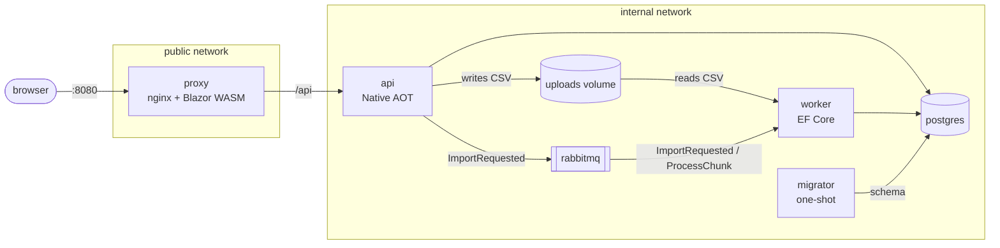

# Fase 04: README de portfólio e demo — plano de implementação

> **Para agentes:** SUB-SKILL OBRIGATÓRIA: usar `superpowers:subagent-driven-development` (recomendado) ou `superpowers:executing-plans`. Os passos usam checkbox (`- [ ]`).

**Objetivo:** reescrever o `README.md` em inglês como vitrine do projeto e criar um gravador reprodutível de `docs/assets/demo.gif`.

**Arquitetura:** `tools/demo/record.sh` recria o stack, gera o CSV e roda uma imagem local com Playwright e `ffmpeg` na rede `public` do compose. O README segue enxuto, com links para os ADRs.

**Stack:** Playwright 1.64.1 (Node, imagem `mcr.microsoft.com/playwright:v1.64.1-noble`), `ffmpeg`, Bash, Docker Compose.

**Design:** [`design.md`](design.md)

## Restrições globais

- Branch `dev/readme-e-demo`, a partir do `master` atualizado. `design.md` e `plan.md` estão sem commit no checkout principal e vão junto para a branch.
- **Nada de commit durante a fase.** O commit sai só no `/finishing-a-development-branch`, com o `project-overview.md` já marcado.
- Sem mudança em `src/`, `compose.yml` ou `.github/`.
- Imagens de terceiros com tag fixa, nunca `latest`.
- `README.md` em inglês; `docs/` e os comentários dos scripts em português.
- Scripts Bash em `set -euo pipefail` + `shopt -s inherit_errexit`; rodam no Git Bash e no Linux.
- O GIF tem menos de 5 MB.

---

### Task 1: gravador da demo e GIF

**Arquivos:**
- Criar: `tools/demo/Dockerfile`, `tools/demo/.dockerignore`, `tools/demo/package.json`, `tools/demo/package-lock.json`, `tools/demo/record.mjs`, `tools/demo/record.sh`
- Criar (gerado): `docs/assets/demo.gif`
- Modificar: `.gitignore`

**Interfaces:**
- Produz: `docs/assets/demo.gif` (usado pelo README na Task 2) e o comando `bash tools/demo/record.sh`.

- [ ] **Passo 1: criar `tools/demo/package.json`**

```json
{
  "name": "statement-importer-demo",
  "private": true,
  "type": "module",
  "dependencies": {
    "playwright": "1.64.1"
  }
}
```

- [ ] **Passo 2: gerar o lockfile**

Run: `MSYS_NO_PATHCONV=1 docker run --rm --mount "type=bind,src=$(pwd -W 2>/dev/null || pwd)/tools/demo,dst=/app" -w /app mcr.microsoft.com/playwright:v1.64.1-noble npm install --package-lock-only`

Esperado: `tools/demo/package-lock.json` criado, sem `node_modules/`.

- [ ] **Passo 3: criar `tools/demo/.dockerignore`**

```
node_modules
```

- [ ] **Passo 4: criar `tools/demo/record.mjs`**

```js
import { chromium } from "playwright";

const pause = 2500;

const browser = await chromium.launch();
const context = await browser.newContext({
  baseURL: "http://proxy:8080",
  viewport: { width: 1280, height: 800 },
  recordVideo: { dir: "/out/video", size: { width: 1280, height: 800 } },
});
const page = await context.newPage();
const video = page.video();

await page.goto("/");
const send = page.getByRole("button", { name: "Enviar" });
await send.waitFor();
await page.locator("input[type=file]").setInputFiles("/data/demo.csv");
await page.waitForTimeout(pause);
await send.click();

await page.waitForURL(/\/imports\//, { timeout: 60_000 });
await page.getByText("concluída com erros").waitFor({ timeout: 120_000 });
await page.waitForTimeout(pause);

await page.getByRole("button", { name: "Linhas rejeitadas" }).click();
await page.waitForTimeout(pause);
await page.getByRole("button", { name: "Transações" }).click();
await page.waitForTimeout(pause);

await page.getByRole("link", { name: "← Importações" }).click();
await page.getByRole("button", { name: "Enviar" }).waitFor();
await page.waitForTimeout(pause);

await context.close();
await video.saveAs("/out/demo.webm");
await browser.close();
```

- [ ] **Passo 5: criar `tools/demo/Dockerfile`**

```dockerfile
FROM mcr.microsoft.com/playwright:v1.64.1-noble
RUN apt-get update && apt-get install -y --no-install-recommends ffmpeg && rm -rf /var/lib/apt/lists/*
WORKDIR /app
COPY package.json package-lock.json ./
RUN npm ci
COPY record.mjs ./
# A aceleração é uniforme (2×): o GIF fica curto sem edição por trechos.
CMD node record.mjs \
 && ffmpeg -y -loglevel error -ss 1 -i /out/demo.webm \
    -filter_complex "setpts=PTS/2,fps=10,scale=960:-1:flags=lanczos,split[a][b];[a]palettegen=max_colors=128:stats_mode=diff[p];[b][p]paletteuse=dither=bayer:bayer_scale=5:diff_mode=rectangle" \
    /assets/demo.gif
```

- [ ] **Passo 6: criar `tools/demo/record.sh`**

```bash
#!/usr/bin/env bash
# Regrava docs/assets/demo.gif. Ferramenta manual, fora do CI. Apaga os volumes do stack.
set -euo pipefail
shopt -s inherit_errexit

cd "$(dirname "$0")/../.."
root=$(pwd -W 2>/dev/null || pwd)

echo "Apagando os volumes do stack: a demo parte de um banco vazio."
docker compose down -v
docker compose up -d --wait --scale worker=3

mkdir -p data/demo docs/assets
[ -f data/demo.csv ] || dotnet run tools/generate-csv.cs -- --lines 1000000 --seed 42 --out data/demo.csv

docker build -t statement-importer-demo tools/demo
MSYS_NO_PATHCONV=1 docker run --rm --init \
  --network statement-importer_public \
  --mount "type=bind,src=$root/data,dst=/data,readonly" \
  --mount "type=bind,src=$root/data/demo,dst=/out" \
  --mount "type=bind,src=$root/docs/assets,dst=/assets" \
  statement-importer-demo

docker compose up -d --wait
ls -l docs/assets/demo.gif
```

- [ ] **Passo 7: acrescentar ao `.gitignore`**

```
tools/demo/node_modules/
```

- [ ] **Passo 8: gravar**

Run (em background; 3 a 5 min): `bash tools/demo/record.sh`

Esperado: termina com exit 0 e `docs/assets/demo.gif` listado, com menos de 5 242 880 bytes. Se passar disso, reduzir nesta ordem: `fps=8`, depois `scale=800:-1`, e regravar.

- [ ] **Passo 9: conferir o GIF**

Extrair quadros em `data/demo/` e abrir com a ferramenta de leitura de imagem:

Run: `MSYS_NO_PATHCONV=1 docker run --rm --entrypoint sh --mount "type=bind,src=$(pwd -W 2>/dev/null || pwd)/data/demo,dst=/out" --mount "type=bind,src=$(pwd -W 2>/dev/null || pwd)/docs/assets,dst=/assets" statement-importer-demo -c "ffmpeg -y -loglevel error -i /assets/demo.gif -vf fps=1/3 /out/frame-%02d.png"`

Esperado: os quadros mostram, em ordem, a home com o arquivo escolhido, a barra de progresso, o status "concluída com erros", a aba de linhas rejeitadas, a aba de transações e a lista com a importação. Sem tela em branco por mais de um quadro: se o carregamento do WASM aparecer, aumentar o `-ss` do Dockerfile.

- [ ] **Passo 10: conferir que o stack voltou**

Run: `docker compose ps --format "{{.Service}} {{.Health}}"`

Esperado: todos `healthy` e um único `worker`.

---

### Task 2: README em inglês

**Arquivos:**
- Modificar: `README.md` (substituição completa)

**Interfaces:**
- Consome: `docs/assets/demo.gif` e `bash tools/demo/record.sh` (Task 1).

- [ ] **Passo 1: conferir as medições no CI**

Abrir `https://github.com/YudiKojima/statement-importer/actions/runs/40980793070` no navegador e ler o job summary. Comparar tamanhos das imagens, tempos de 1 × 3 workers e demais números com a tabela do passo 2. O número que divergir de forma real é atualizado na tabela (os tempos do CI vêm de outra máquina: os do README são os medidos neste repositório, e o texto diz isso).

- [ ] **Passo 2: substituir o `README.md`**

````markdown
# statement-importer

[](https://github.com/YudiKojima/statement-importer/actions/workflows/ci.yml)

Async CSV bank-statement import pipeline: a .NET 10 Docker portfolio project.

## The problem

Importing a large CSV inside an HTTP request times out, duplicates data when the user retries, and shows no progress. This project solves that with an asynchronous pipeline: the API stores the file and responds immediately, and workers process the CSV in idempotent chunks.

Every Docker concept here (image, build, volume, network, compose) exists because the system needs it, and each claim below is checked by an executable proof in CI.

## Demo


One million lines, three workers, sped up 2×. The UI is in Portuguese.

## Architecture



- **proxy**: unprivileged nginx. Serves the Blazor WebAssembly frontend and forwards `/api`. The only published port (8080).
- **api**: Minimal API in Native AOT on a chiseled image with no shell. Streams the upload to disk, computes its SHA-256 and publishes to the queue.
- **worker**: EF Core. Processes 10,000-line chunks and acks only after the commit, so a killed worker never duplicates data.
- **migrator**: EF Core migrations bundle. Runs once and exits before `api` and `worker` start.
- **postgres 17** and **rabbitmq 4** (quorum queues), internal network only.

## Quick start

Requires Docker with Compose. The .NET 10 SDK is needed only for the CSV generator.

```bash
for s in postgres_password db_owner_password db_app_password; do cp secrets/$s.txt.example secrets/$s.txt; done
docker compose up -d --wait
```

Open `http://localhost:8080` to upload a file and follow its progress, rejected lines and imported transactions. Interactive API docs are at `http://localhost:8080/api/docs`.

To generate a 1M-line CSV and send it with `curl`:

```bash
dotnet run tools/generate-csv.cs -- --lines 1000000 --seed 42 --out data/1m.csv
curl -X POST --data-binary @data/1m.csv -H "Content-Type: text/csv" "localhost:8080/api/imports?fileName=1m.csv"
```

The `202` response carries the `id`; progress is at `GET localhost:8080/api/imports/{id}`.

To compare one and three workers: `docker compose up -d --wait --scale worker=3`.

## Verified measurements

Taken on the real stack, using this repository's `compose.yml`.

| Scenario | Result |
|---|---|
| Upload of 1M lines (~50 MB) | `202` in ~0.25 s |
| Processing with 1 worker | ~36 s |
| Processing with 3 workers | ~15 s |
| `docker kill` on a worker mid-import | exact count, zero duplicates |
| RabbitMQ stopped | `api` and `worker` restart through the restart policy and return `healthy` |
| `process-chunk` queue purged | the reconciler republishes the 81 pending chunks |
| Upload above 200 MB | `413`, no file left behind |
| Compressed image size | `api` 18.0 MB · `worker` 46.6 MB · `migrator` 50.6 MB · `proxy` 32.7 MB |
| Container user | UID 1654 (non-root); UID 101 on the proxy |

The 1M-line rows, the upload limit, image sizes and container users are verified by the proofs on every push. The RabbitMQ and reconciler rows were measured by hand in phase 01. Each CI run's job summary shows the sizes, the 1 × 3 worker timings and a CVE comparison between the chiseled and standard images.

## Design decisions

Each record explains the context and alternatives, in Portuguese.

- [**Native AOT API, EF Core worker**](docs/architecture/decisions/0001-api-aot-worker-ef-core.md): a small, fast-starting API image with Dapper.AOT; the worker keeps EF Core where AOT brings no benefit.
- [**Healthcheck from the binary itself**](docs/architecture/decisions/0002-healthcheck-pelo-proprio-binario.md): shell-less images have no `curl`, so the app checks itself.
- [**Idempotent chunks, ack after commit**](docs/architecture/decisions/0003-processamento-em-blocos-idempotente.md): a crash means reprocessing, never duplicates.
- [**CPU and memory limits on the worker**](docs/architecture/decisions/0004-limite-de-recursos-no-worker.md): 0.5 CPU and 256 MB make scaling measurable and protect the host.
- [**One-shot migrator**](docs/architecture/decisions/0005-schema-do-ef-core-aplicado-por-migrator.md): the schema is applied by a dedicated container, not by the apps at startup.
- [**Least-privilege database roles**](docs/architecture/decisions/0006-papeis-de-banco-com-privilegio-minimo.md): `api` and `worker` only read and write data; the `migrator` owns the schema.
- [**Executable proofs against the real stack**](docs/architecture/decisions/0007-provas-executaveis-contra-o-stack-real.md): claims in this README are checked in CI, not just stated.
- [**Proxy as the single edge**](docs/architecture/decisions/0008-proxy-como-unica-borda.md): one nginx serves the frontend and `/api`, and the API stays on the internal network.

## Proofs

With the stack running:

```bash
bash proofs/run-all.sh
```

It takes a few minutes and includes three 1M-line imports. Each proof also runs alone, for example `bash proofs/resilience.sh`. If your machine already uses ports 5432, 5672 or 15672, run `IGNORE_HOST_PORTS=5432 bash proofs/run-all.sh`; CI never sets this variable.

| Proof | What it checks |
|---|---|
| `healthy.sh` | Every service is healthy within 60 s and the migrator exits with code 0 |
| `network.sh` | Only the proxy publishes a port; the API is on the internal network only |
| `proxy.sh` | SPA fallback, `/api` forwarding and the 200 MiB upload limit |
| `security.sh` | No root and no shell in app containers; low-privilege database role |
| `image-size.sh` | Compressed image sizes within target |
| `volume.sh` | Data survives `compose down` + `up` |
| `scale.sh` | Measures 1 × 3 workers on a 1M-line import |
| `resilience.sh` | Killing a worker mid-import still gives an exact count |

CI also runs 39 unit tests and 21 integration tests with Testcontainers (real Postgres and RabbitMQ), scans the images with Trivy and publishes them to GHCR.

## Recording the demo

`bash tools/demo/record.sh` regenerates `docs/assets/demo.gif` with Playwright and ffmpeg in a container. It deletes the stack's volumes so the demo starts from an empty database.

## Documentation

In Portuguese:

- [System design](docs/architecture/system-design.md): services, data flow, images, tests and CI.
- [Architecture decision records](docs/architecture/decisions/).
- [Project overview and phases](docs/project-overview.md).
````

Conferir antes de salvar se as contagens de testes (39 e 21) continuam certas: `dotnet test` da Task 3 mostra os totais; ajustar o texto se divergirem.

- [ ] **Passo 3: conferir os links relativos**

Run:

```bash
grep -oE '\]\((docs|tools|proofs)[^)#]*\)' README.md | sed -E 's/^\]\(|\)$//g' | sort -u | while read -r p; do [ -e "$p" ] && echo "ok  $p" || echo "FALTA $p"; done
```

Esperado: só linhas `ok`.

- [ ] **Passo 4: conferir que nenhum ADR ficou de fora**

Run: `ls docs/architecture/decisions/0*.md | wc -l; grep -c 'decisions/0' README.md`

Esperado: `8` e `8`.

---

### Task 3: documentação e verificação final

**Arquivos:**
- Modificar: `docs/architecture/system-design.md:56` (árvore), `docs/architecture/system-design.md:300` (ordem do README), `docs/README.md`

**Interfaces:**
- Consome: tudo das Tasks 1 e 2.

- [ ] **Passo 1: atualizar a árvore do `system-design.md`**

Depois da linha `├─ tools/generate-csv.cs ...`:

```
├─ tools/demo/                        gravador do GIF da demo (Playwright + ffmpeg em container)
```

- [ ] **Passo 2: atualizar a seção README do `system-design.md`**

Substituir a linha da ordem por:

```markdown
Em inglês (`docs/` e ADRs seguem em português). Badge do CI → problema → GIF da demo → diagrama Mermaid → `docker compose up` → tabela de medições → decisões (links para os ADRs) → como rodar as provas → como regravar a demo. O GIF é gerado por `tools/demo/record.sh`, ferramenta manual fora do CI.
```

- [ ] **Passo 3: incluir a fase em `docs/README.md`**

Depois da linha da fase 03:

```markdown
| 04 — README de portfólio e demo | [`features/04-readme-e-demo/`](features/04-readme-e-demo/) |
```

- [ ] **Passo 4: verificação completa**

Com `superpowers:verification-before-completion`, rodar em sequência (em background quando passar de 2 min):

```bash
dotnet build StatementImporter.slnx -warnaserror
dotnet test --project tests/StatementImporter.UnitTests
dotnet test --project tests/StatementImporter.IntegrationTests
docker compose build
docker compose up -d --wait
IGNORE_HOST_PORTS=5432 bash proofs/run-all.sh
```

Esperado: 0 avisos, testes verdes e todas as provas passando. Ajustar as contagens de testes do README se os totais forem outros.

- [ ] **Passo 5: conferir a renderização**

Depois do push da branch, abrir `https://github.com/YudiKojima/statement-importer/blob/dev/readme-e-demo/README.md` no navegador e conferir GIF, Mermaid, badge e tabelas.

- [ ] **Passo 6: finalizar**

Seguir `/requesting-code-review` e `/finishing-a-development-branch`, com a fase 04 marcada como `✅ Concluída (AAAA-MM-DD)` em `docs/project-overview.md` no mesmo commit final. Antes do commit, marcar o script como executável:

```bash
git add tools/demo/record.sh
git update-index --chmod=+x tools/demo/record.sh
```

Abrir o PR e conferir `gh pr checks`.
